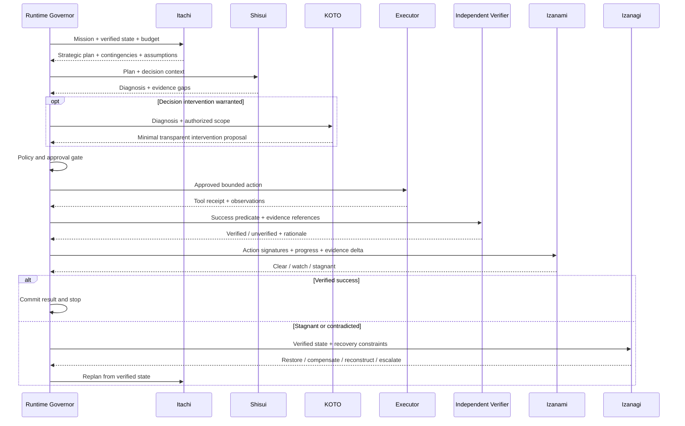

# Interactions — How the Five Concepts Work Together

## Responsibility flow

1. **Itachi** produces a future-oriented plan and records assumptions, contingencies, and the next small action.
2. **Shisui** independently checks the decision conditions: what is blocking the choice, what evidence is missing, and whether the plan fits the actual decision criteria.
3. **KOTO** is called only when there is a real decision-state problem. It supplies a minimal, transparent intervention and routes the change through the proper approval boundary.
4. **Governor** authorizes or denies the next operation. Agents cannot bypass it.
5. **Executor** acts and returns tool receipts plus external artifacts.
6. **Verifier** checks reality against the success predicate.
7. **Izanami** detects whether the run is progressing or reproducing a failure.
8. **Izanagi** performs bounded recovery if necessary; Itachi and Shisui then re-evaluate against the newly verified state.

## Sequence diagram

## Example: a deployment agent repeats itself

1. Itachi proposes a canary deployment and a rollback contingency.
2. Shisui notes the approval is blocked because the owner requires a readiness signal that the plan has not provided.
3. KOTO surfaces the missing health-check evidence and proposes a reversible canary with explicit metrics; it does not pressure the owner or bypass approval.
4. The governor checks permissions and requests approval.
5. The executor deploys the approved canary.
6. The verifier finds that the canary fails the error-rate criterion.
7. Izanami detects that changing prompt wording or retrying the same deployment would not add evidence; the rollout is paused.
8. Izanagi restores the last safe configuration (or runs a pre-authorized compensation), verifies it, and sends the failure evidence to Itachi.
9. Itachi revises the hypothesis; Shisui rechecks whether the decision criterion is now satisfied. The system resumes only through the same policy gates.

## Design rule

The agents can share evidence and challenge one another's assumptions, but none should be the sole judge of its own success, authority, or recovery correctness.
